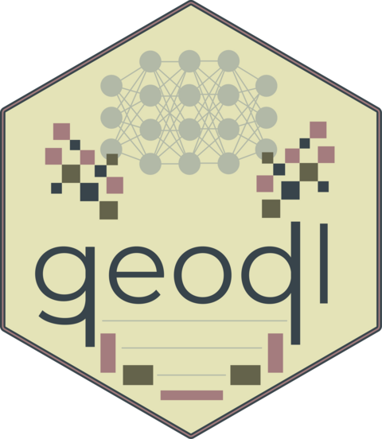

<!-- README.md is generated from README.Rmd. Please edit that file -->

```{r, include = FALSE}
knitr::opts_chunk$set(
  collapse = TRUE,
  comment = "#>",
  fig.path = "man/figures/README-",
  out.width = "100%"
)
```

# geodl 

<!-- badges: start -->
<!-- badges: end -->

geodl provides tools for geospatial semantic segmentation using convolutional neural network-based deep learning, built on torch and terra. It includes several configurable UNet-family model architectures, utilities for preparing and augmenting image chips, loss functions and training metrics for use with luz, and functions for generating spatial predictions and assessing accuracy. Models can be trained using a CUDA-enabled GPU and do not require a Python environment.

Full details are described in:

Maxwell, A.E., Farhadpour, S., Das, S. and Yang, Y., 2024. geodl: An R package for geospatial deep learning semantic segmentation using torch and terra. *PLoS One*, 19(12), p.e0315127. [https://doi.org/10.1371/journal.pone.0315127](https://journals.plos.org/plosone/article?id=10.1371/journal.pone.0315127)

## Installation

You can install the development version of geodl from
[GitHub](https://github.com/) with:

``` r
# install.packages("devtools")
devtools::install_github("maxwell-geospatial/geodl")
```

## Documentation

Full documentation, including a function reference, is available at the [pkgdown website](https://www.wvview.org/geodl/index.html).

Chapters [22](https://www.wvview.org/gslr/c22geodlData.html), [23](https://www.wvview.org/gslr/c23geodlModels.html), [24](https://www.wvview.org/gslr/c24geodlBinary.html), and [25](https://www.wvview.org/gslr/c25geodlMulticlass.html) of the free and openly available online text [*Geospatial Supervised Learning using R*](https://www.wvview.org/gslr/index.html) provide detailed workflows and explanations.
